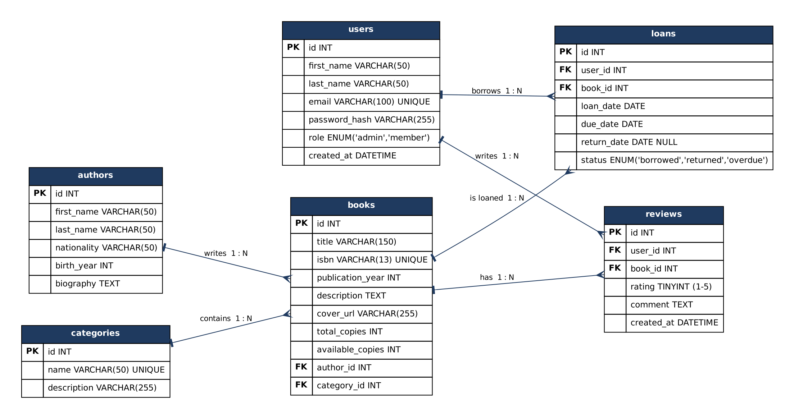
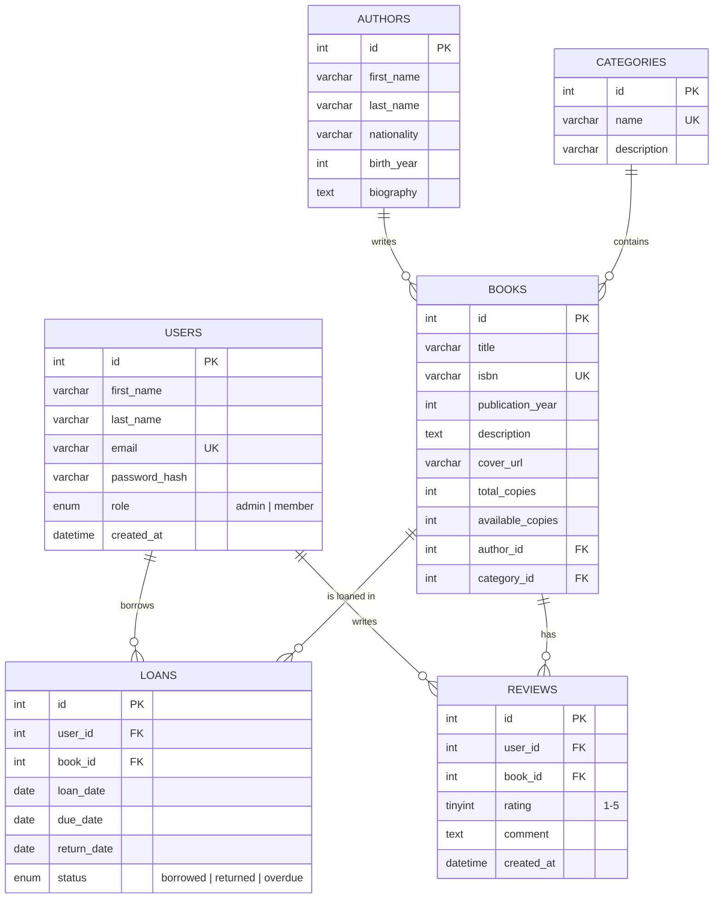

# Entity-Relationship Diagram (draft)

The PNG is generated from `erd.dot` (Graphviz): `dot -Tpng docs/erd.dot -o docs/erd.png`.
The same model as a Mermaid diagram (rendered automatically by GitHub):

## Relationships

| Relationship | Type | Foreign key |
|---|---|---|
| An author writes many books | 1 : N | `books.author_id → authors.id` |
| A category contains many books | 1 : N | `books.category_id → categories.id` |
| A user has many loans | 1 : N | `loans.user_id → users.id` |
| A book appears in many loans | 1 : N | `loans.book_id → books.id` |
| A user writes many reviews | 1 : N | `reviews.user_id → users.id` |
| A book has many reviews | 1 : N | `reviews.book_id → books.id` |

`loans` and `reviews` also act as the link between `users` and `books` (a many-to-many relationship resolved through these two tables).
