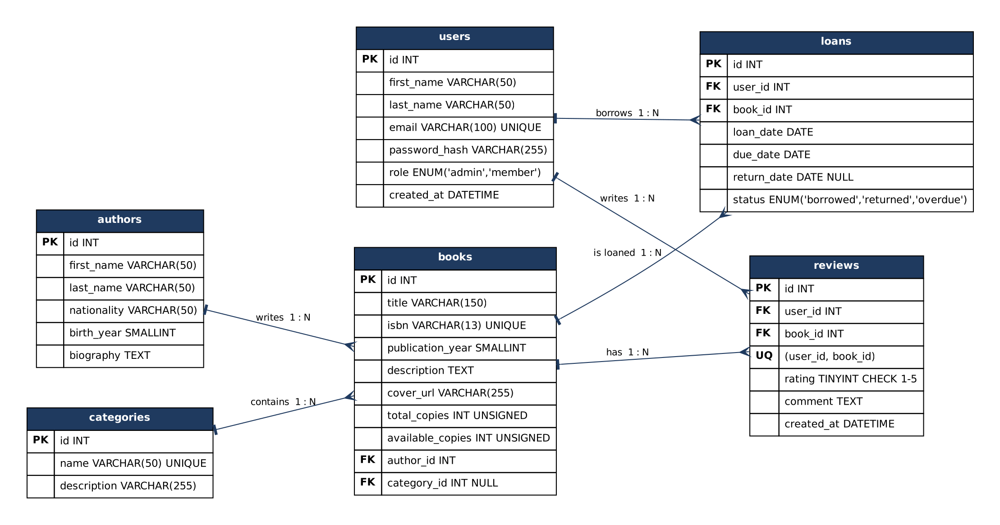
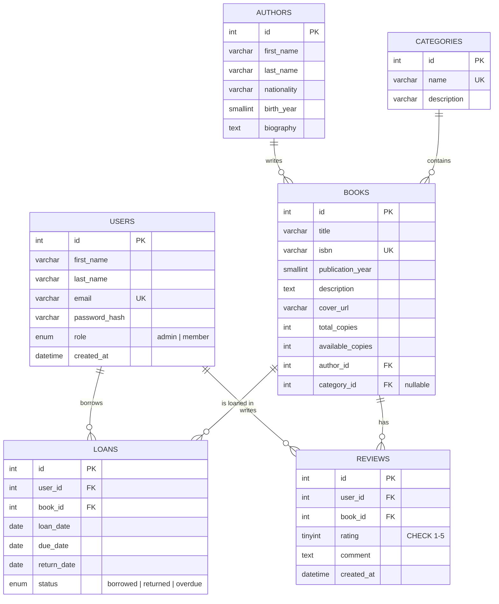

# Entity-Relationship Diagram

The PNG is generated from `erd.dot` (Graphviz): `dot -Tpng docs/erd.dot -o docs/erd.png`.
The same model as a Mermaid diagram (rendered automatically by GitHub):

## Relationships

| Relationship | Type | Foreign key |
|---|---|---|
| An author writes many books | 1 : N | `books.author_id → authors.id` |
| A category contains many books | 1 : N | `books.category_id → categories.id` |
| A user has many loans | 1 : N | `loans.user_id → users.id` |
| A book appears in many loans | 1 : N | `loans.book_id → books.id` |
| A user writes many reviews | 1 : N | `reviews.user_id → users.id` |
| A book has many reviews | 1 : N | `reviews.book_id → books.id` |

`loans` and `reviews` also act as the link between `users` and `books` (a many-to-many relationship resolved through these two tables).

## Constraints and delete rules

The SQL implementation is in [`database/library_db.sql`](../database/library_db.sql).

| Foreign key | On delete | Reason |
|---|---|---|
| `books.author_id` | `RESTRICT` | An author who still has books cannot be deleted |
| `books.category_id` | `SET NULL` | Deleting a category keeps its books, without a category |
| `loans.user_id`, `loans.book_id` | `CASCADE` | Loans are removed together with the user or book |
| `reviews.user_id`, `reviews.book_id` | `CASCADE` | Reviews are removed together with the user or book |

Other constraints:
- `users.email`, `categories.name` and `books.isbn` are `UNIQUE`.
- `reviews (user_id, book_id)` is `UNIQUE`: a user can review a book only once.
- `CHECK` constraints: `reviews.rating` between 1 and 5, `books.available_copies <= total_copies`, `loans.due_date >= loan_date`.
